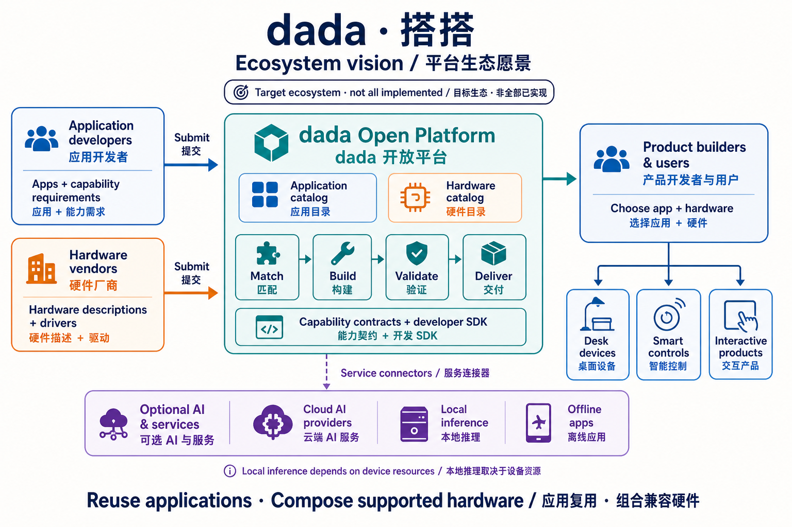
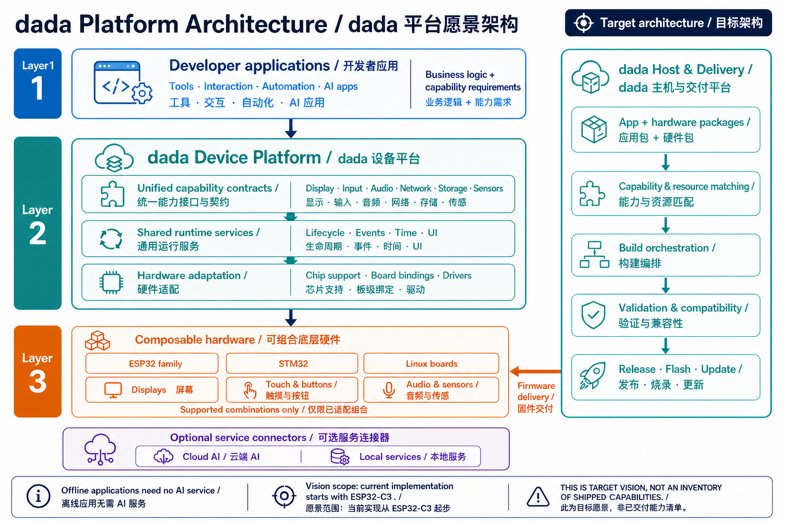

# dada · 搭搭

**连接应用与硬件，让开发者专注产品。**

dada 致力于连接应用开发者与硬件生态。
硬件厂商提交硬件描述与驱动，开发者构建硬件无关的应用，dada 负责匹配、构建、验证和交付。

[English](README.md) · **简体中文**

[开发指南](docs/development.md) · [架构路线](docs/architecture/incremental-roadmap.zh-CN.md) · [参与贡献](CONTRIBUTING.md)

> 当前阶段：ESP32-C3 首板验证。以下生态和架构图展示平台愿景，已实现能力见「当前进展」。

## 平台愿景：应用与硬件自由组合



应用开发者描述业务与能力需求；硬件厂商提供芯片、开发板和外设的描述、驱动及验证资料。
平台连接双方，让产品开发者与用户选择应用和兼容硬件组合，减少重复适配与工具切换。
应用可接不同 AI 服务、使用本地服务，也可完全离线运行；本地模型推理受设备资源限制。

## 全局架构：设备平台与交付平台



- **开发者应用**：业务、交互和能力需求，尽量复用同一份源码。
- **设备平台**：统一能力接口与契约、通用运行服务、芯片与板级适配、外设驱动。
- **底层硬件**：经过适配和验证的芯片、开发板、显示屏、输入、音频及传感模块组合。
- **主机与交付平台**：应用包与硬件包、能力和资源匹配、构建编排、验证报告、发布与更新。

应用复用以能力兼容、资源匹配和实机验证为基础；针对目标硬件构建固件。
运行服务按需裁剪，主机工具可在本地运行。ESP32 是起点，其他 MCU 与 Linux 板卡将逐步验证。
应用可选择云端 AI、本地服务或完全离线运行。

## 当前进展

- 首板：金逸晨 ESP32-C3 + 2.4 寸 ST7789 屏 + CST836U 触摸，工具链 **ESP-IDF v5.4.2**。
- 已有显示/输入契约、可复用驱动、板级清单及配置头文件生成。
- 两个可选择的原生 C 应用：`touch-counter` 触摸计数器（默认）、`bringup` 色带与触摸诊断。
- 已有实验性的单应用生命周期、服务注入、主机测试与本地交付 CLI。
- 色带颜色和触摸事件已获实机确认；计数器交互与断电重启单独记录在
  [硬件记录](tests/hardware/records/)中。

尚无通用运行时、应用 IR 编译器、自动硬件发现、包市场、AI 连接器和第二块受支持的板子。
先用原生 C 应用检验契约；[ADR 0005](docs/adr/0005-app-ir.md) 的声明式应用仍是提案。

## 快速开始

先激活已安装的 ESP-IDF v5.4.2 环境，再在仓库根目录执行：

```sh
python tools/dada.py check
python tools/dada.py build
python tools/dada.py ports
python tools/dada.py flash --port YOUR_PORT
python tools/dada.py monitor --port YOUR_PORT
# 切换到硬件诊断应用，使用独立构建目录：
python tools/dada.py build --app bringup
```

烧录会替换原固件，需要恢复时请保留备份。
环境安装见[开发指南](docs/development.md)，交互说明见[计数器说明](apps/touch-counter/README.zh-CN.md)。

## 从首板到平台

**计数器闭环 → 离线番茄钟 → 第二块板 → 外部硬件贡献 → 应用生态**

先用真实应用提取公共服务，再用第二块板检验源码复用，最后开放可复现的第三方接入流程。
每一步的验收条件见[分阶段路线](docs/architecture/incremental-roadmap.zh-CN.md)。

| 想了解什么 | 入口 |
| --- | --- |
| 当前 C3 实现与交付流程 | [实现架构](docs/architecture/current-implementation.md) |
| 环境安装、构建、烧录与团队协作 | [开发指南](docs/development.md) |
| 能力契约、板级清单、应用形态 | [架构决策 ADR](docs/adr/README.md) |
| 命令行工具与清单校验 | [主机工具](tools/README.md) |
| 实机测试证据与待验收项目 | [硬件记录](tests/hardware/records/) |

## 测试与协作

```sh
cmake -S tests/host -B /tmp/dada-host
cmake --build /tmp/dada-host
ctest --test-dir /tmp/dada-host --output-on-failure
python3 -m unittest discover -s tests/host -p 'test_*.py'
```

见 [CONTRIBUTING.md](CONTRIBUTING.md)、[架构决策](docs/adr/README.md)与[主机工具](tools/README.md)。
CI 编译两个应用并运行主机及清单检查，显示和触摸仍需实机验收记录。
不上传或复制没有合适许可证的商家示例；`dada verify` 尚未实现。

代码、提交信息用英文，文档逐步提供中英版本。

## 许可证

项目计划开源，许可证尚待选定，见 [ADR 0004](docs/adr/0004-license.md)。
