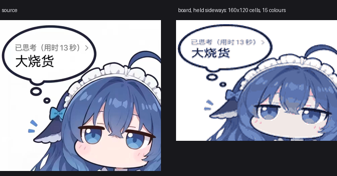

# 像素头像

使用 `contracts/app.h` 的、与硬件无关的原生 C 应用。
English: [README.md](README.md)。



显示一帧 160×120、15 色的画面，旋转后铺满竖屏面板——把板子横过来看就是正的。

仓库内置一帧（`frames/whale-f0.h`），所以 clone 下来直接构建就能显示，不需要任何准备步骤。
素材来源与许可见 [NOTICE.md](NOTICE.md)：它是第三方同人图，**不属于** Apache-2.0。

- 帧格式：160×120 格、4 bit/格（9600 字节），调色板与 `paint` 相同。
- 优先级：NVS 里 `whale.f0` 有数据就用它，否则用内置帧。
- 换成自己的图：

  ```sh
  python tools/image_to_frame.py my-art.png apps/whale/frames/whale-f0.h
  ```

  这会直接重写内置帧。长度与网格不符的帧会被拒绝，而不是画一半。
- 渲染按 8 行条带进行（3.8 KB），而不是申请整块 240×320 帧缓冲（150 KB）——
  后者在有其他数据驻留时拿不到连续内存。
- **未实现眨眼**。三帧过渡和"画眼皮"两种做法最后都变成头发上的一块浅色方块；
  要做得自然，需要手绘闭眼帧。

```sh
python tools/dada.py build --app whale
python tools/dada.py flash --app whale --port YOUR_PORT
```
