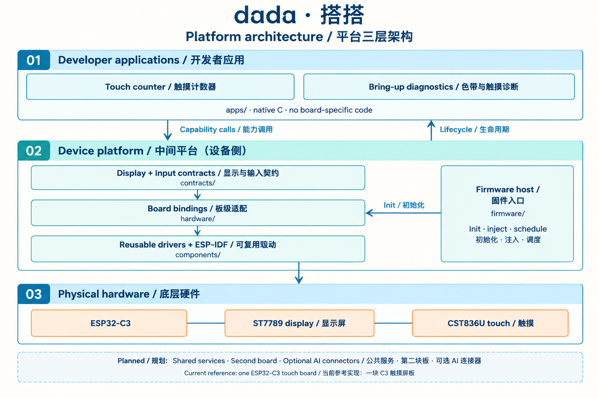
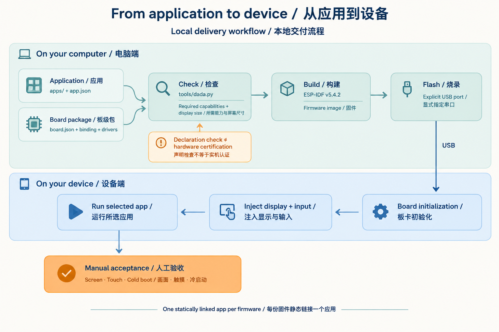

# Current C3 implementation / 当前 C3 实现

These diagrams explain the first implementation, not the full platform vision.
平台整体愿景见[项目首页](../../README.zh-CN.md)，本页只说明当前 C3 验证切片。

## Device layers / 设备侧分层

应用通过显示、输入契约访问驱动，固件入口负责板初始化、服务注入和应用调度。
当前只有一个 C3 板级实现，公共运行服务和其他硬件目标仍待验证。

## Local delivery / 本地交付

本地 CLI 检查能力声明，调用 ESP-IDF 构建并通过指定端口烧录。
每份固件静态链接一个应用。画面、触摸与冷启动需单独实机验收；流程图不代表验收已通过。

See [development commands](../development.md) and [incremental roadmap](incremental-roadmap.zh-CN.md).
