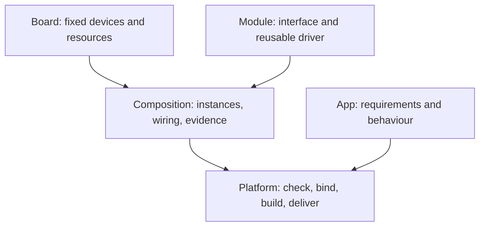

# Developer entry points and platform boundaries

This page separates implemented functionality from the agreed direction for dada.

[简体中文](developer-boundaries.zh-CN.md) · [README](../../README.md)

## Choose a contribution

Only the Jinyichen ESP32-C3 with its 2.4-inch display and touch panel is currently supported. The S3 manifest records planned hardware, not an implemented target. Builds use PlatformIO Core 6.2.0 with Espressif32 6.8.1 and ESP-IDF v5.3.0, selecting one board and one native C app.

| Goal | Start here | Deliverable and evidence |
| --- | --- | --- |
| Build an app | `apps/touch-counter/`, `apps/focus-clock/`, `contracts/` | App manifest, lifecycle implementation, CMake integration, tests, documentation and physical interaction checks |
| Support another C3 board | [Board guide](../hardware/board-contribution.md), `hardware/<vendor>/<board>/` | Sourced hardware facts, binding, licensed drivers and capability-specific hardware records |
| Attach a peripheral | Exact module documentation and available board interfaces | Wiring evidence, minimal driver integration and coexistence tests before extracting module/composition abstractions |
| Improve platform tooling | `tools/`, `firmware/`, `contracts/`, `tests/` | Reproducible build diagnostics, checks and delivery workflows that preserve existing apps |
| Test or document | `tests/hardware/records/`, `docs/` | Board revision, procedure, logs, observed results and explicit untested items |

A new app needs more than a directory: follow existing app.json, CMake and lifecycle implementations, run check/build, and update app lists, CI matrices and documentation as appropriate. Interfaces remain experimental.

## App and hardware responsibilities

Apps use display, input, time and storage contracts. Keep concrete board names, GPIO operations, controller initialization and chip-specific business branches out of apps. Board bindings connect services to hardware; reusable drivers live in `components/`.

Board contributors still need vendor documentation, schematics and datasheets, and may inspect sample initialization facts. App authors normally do not. A manifest does not implement a driver; compilation does not establish physical compatibility. Even two C3 boards can differ in display, touch, wiring, memory and USB interface.

Hardware independence means independence from specific models, not universal compatibility. Display size, input semantics and resource requirements still matter. Today's CLI checks limited capabilities and display dimensions, not all resource constraints.

## Agreed direction: board + module + composition

This diagram is a target model. Board/app integration exists; independent module packages, composition resolution and comprehensive conflict checks do not.

- A board package owns fixed onboard devices. Keep the current integrated board at `hardware/jinyichen/esp32-c3-lcd-2.4/`.
- A module describes signals, bus/electrical requirements and driver binding without hard-coding host-board GPIOs.
- A composition identifies the board, module instances, actual connections and integration evidence. Wiring changes here when the same module moves to another board.
- An app requests capabilities rather than amplifier models or pin numbers.

Proposed paths are `hardware/modules/<vendor>/<module>/` and `hardware/compositions/<id>/`. They are not currently supported package formats. Do not migrate existing board directories or create empty scaffolding merely to match the diagram. With no new hardware available, improve the existing experience first; implement a real peripheral, then extract reusable abstractions.

## Wiring and evidence

An unlisted GPIO is not necessarily available. Check physical exposure, onboard occupancy, Flash/USB, boot conditions and electrical requirements. GPIO 4/5/6 from an earlier illustrative discussion are occupied by touch/display on the current board, not speaker wiring recommendations.

Passive speakers generally need an amplifier; audio output and microphone input are separate capabilities. Shared SPI/I²C needs compatible bus configuration, addressing/chip selection and driver support. The current display has CS tied low; do not assume its SPI bus can be shared.

A module tested elsewhere does not certify this combination. Verify coexistence with onboard functions. Wiring, driver or hardware revision changes require reviewing evidence scope. Distinguish declarations, builds and physical observations; never manufacture historical test evidence.

## Required and optional capabilities

| Situation | Behaviour/status |
| --- | --- |
| A current app lacks a required capability | check/build rejects it; do not weaken requirements to hide missing functionality |
| Declared capability is unverified | Explicit `--allow-unverified` permits diagnostic selection, still requiring a binding/implementation; it does not certify support |
| A future app requires sound | Target design requires an audio-output implementation and verified combination for normal delivery |
| Sound is optional | Target design lets the app disable sound or provide visual feedback explicitly |

Audio contracts, module selection and complete optional-capability handling are not implemented. An illustrative `optional: [audio]` field is not a supported API. Future required-service initialization failures must clean up and stop; optional failures can degrade according to app policy. Some peripherals lack readback, so software cannot guarantee physical disconnection detection.

## Near-term sequence

1. Make the current board's apps, setup, evidence and contribution workflow reproducible.
2. Prepare a path toward board-specific prebuilt firmware and easier flashing. Browser flashing and SDK-free delivery are not shipped yet.
3. Use an actual peripheral or second board to validate reuse.
4. Implement module/composition tooling from that evidence, then expand distribution.

Do not promise automatic wiring discovery, universal ESP32 binaries, dynamic drivers or a package marketplace. AI integrations remain optional future work; offline apps should not require cloud accounts.

See the [detailed composition proposal, implementation deferred](../superpowers/specs/2026-10-27-hardware-composition-design.md), [roadmap](incremental-roadmap.md), [contribution rules](../../CONTRIBUTING.md) and [agent guide](../../AGENT.md).
