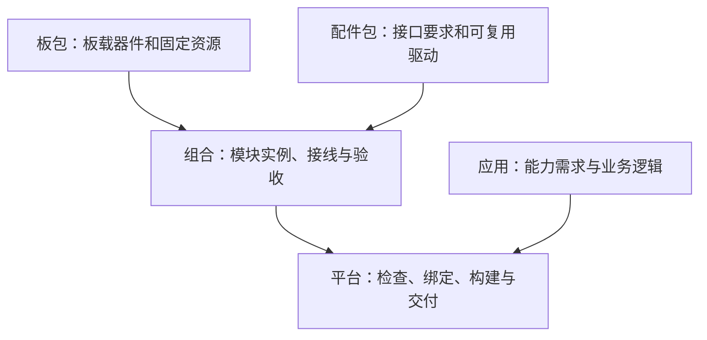

# 开发者入口与平台边界

本文记录 dada 当前的贡献分工和已确认的架构方向。设计方向不等于已经实现的功能。

[English](developer-boundaries.md) · [返回 README](../../README.zh-CN.md)

## 当前可以做什么

目前只有金逸晨 ESP32-C3 + 2.4 寸屏 + 触摸这一套受支持硬件。S3 的清单是计划资料，不代表已有适配。当前构建基线是 PlatformIO Core 6.2.0、Espressif32 6.8.1 + ESP-IDF v5.3.0，每次选择一个板包和一个原生 C 应用。

| 你的目标 | 从哪里开始 | 贡献什么 | 完成依据 |
| --- | --- | --- | --- |
| 在现有板上开发应用 | `apps/touch-counter/`、`apps/focus-clock/`、`contracts/` | 应用源码、app.json、说明和测试 | 主机测试、目标固件构建、交互实测 |
| 接入新的 C3 开发板 | [板卡指南](../hardware/board-contribution.zh-CN.md)、`hardware/<vendor>/<board>/` | 有来源的硬件描述、板级绑定、所需驱动及验收记录 | 诊断固件运行、能力逐项验证、兼容应用实测 |
| 给板子接配件 | 先提供具体模块资料和板上可用接口 | 接线依据、驱动许可、最小实验及测试结果 | 真实模块与板载功能共存，之后提取模块/组合结构 |
| 改善平台与工具 | `tools/`、`firmware/`、`contracts/`、`tests/` | 构建诊断、测试、贡献流程、交付工具 | 可复现的正常与错误路径，不影响现有应用 |
| 帮助验证与写文档 | `tests/hardware/records/`、`docs/` | 精确板型、步骤、日志、结果和未测项 | 其他人可按相同条件复现 |

新应用不是只新建一个目录就算接入完成：参考现有 app.json、CMakeLists.txt 和生命周期实现，运行 CLI 的 check/build；按改动更新可选应用列表、CI 构建矩阵和文档。接口目前仍是实验版本。

## 应用和硬件如何解耦

应用通过 `contracts/` 使用显示、输入、时间和存储服务，不直接操作 GPIO、不引用具体板名或控制器、不增加按芯片区分的业务分支。板级绑定把契约连接到真实实现，可复用驱动放在 `components/`。

硬件贡献者仍需阅读商家资料、原理图和数据手册，必要时参考示例确认时序与参数；应用开发者通常不需要这些资料。清单不能替代驱动，编译不能替代实机验证。同为 C3，也可能有不同屏幕、触摸、引脚、Flash 和 USB 接口。

“硬件无关”指不依赖具体型号，不表示所有硬件都能跑所有应用。分辨率、输入语义、内存等要求仍需满足。当前 CLI 只做有限能力与显示尺寸检查，尚无完整资源匹配器。

## 已确认方向：板 + 配件 + 组合

上图是目标关系。当前现有板包和应用链路已存在；独立配件包、组合解析与完整冲突检查尚未实现。

- **板**记录固定板载屏幕、触摸、主控和资源；当前一体板继续整体保留在 `hardware/jinyichen/esp32-c3-lcd-2.4/`。
- **配件**记录模块型号、信号、总线、电气要求及驱动绑定，不固定到某块板的 GPIO。
- **组合**记录哪块板接哪些配件，以及每个实例的接线和验证证据。同模块接不同板，接线在这里变化。
- **应用**只表达所需能力，不选择某款功放或 GPIO。

未来建议路径为 `hardware/modules/<vendor>/<module>/` 和 `hardware/compositions/<id>/`；这是设计约定，不是当前可用包格式。现阶段不迁移现有板包，也不创建空目录或仅靠虚拟例子构建通用框架。当前没有新硬件，先完善现有板的体验和贡献流程；有真实配件后完成最小适配，再提取模块与组合结构。

## 配件、引脚与验证的边界

板上未在清单列出的 GPIO 不等于可用：还要确认实际引出、板载占用、Flash/USB、启动条件和电气要求。此前讨论中的 GPIO 4/5/6 只是错误示例，它们在当前板上已被触摸/显示占用，不能作为扬声器接线。

无源扬声器通常需要功放；音频输出与麦克风输入是不同能力。SPI/I²C 共享需要总线、地址、片选和驱动支持，不能只检查引脚是否重复。当前屏幕 CS 固定为低，不可假定其 SPI 总线可共享。

模块在别的板上跑通不代表当前组合已验证。增加配件后需检查与屏幕、触摸等板载功能共存。接线、驱动或硬件修订改变时，记录适用范围并重新评估验证。清单、编译结果、实测结果必须分开；不回填未经证实的历史测试证据。

## 应用需要扬声器时怎么办

| 情况 | 当前或目标行为 |
| --- | --- |
| 当前应用的必需能力缺失 | 当前 check/build 拒绝；不能靠修改声明掩盖缺失 |
| 能力已声明但尚未实测 | 当前可显式使用 `--allow-unverified` 做诊断；仍需绑定和实现，不代表已支持 |
| 未来应用必须播放声音 | 目标设计要求有音频输出驱动及已验证组合，否则拒绝正式构建/交付 |
| 未来应用音效可选 | 目标设计允许缺少音频，由应用明确关闭音效或提供视觉提示 |

当前没有音频契约、模块组合选择和完整 optional 能力处理。不能把示意的 `optional: [audio]` 当成已经可用的 API。未来初始化必需服务失败应清理并终止；可选服务失败才可以按应用约定降级。某些设备没有读回通道，软件不保证能检测物理断线。

## 近期优先级与暂缓内容

1. 让现有板上的应用、构建说明、验收记录和贡献入口易于复现。
2. 规划针对明确板型的预编译固件与便捷刷机；网页刷机和免 SDK 体验目前尚未交付。
3. 拿到真实配件或第二块板后，用实际适配验证复用边界。
4. 根据这些证据落地模块/组合解析，再考虑更完整的包分发。

不自动发现未知接线、不承诺任意 ESP32 通用固件、不提前实现动态驱动或包市场。AI 服务属于后续可选集成，离线应用不应依赖云账号。

进一步阅读：[详细组合设计（实施暂缓）](../superpowers/specs/2026-10-27-hardware-composition-design.md)、[增量路线](incremental-roadmap.zh-CN.md)、[贡献规则](../../CONTRIBUTING.md)、[智能体指南](../../AGENT.md)。
