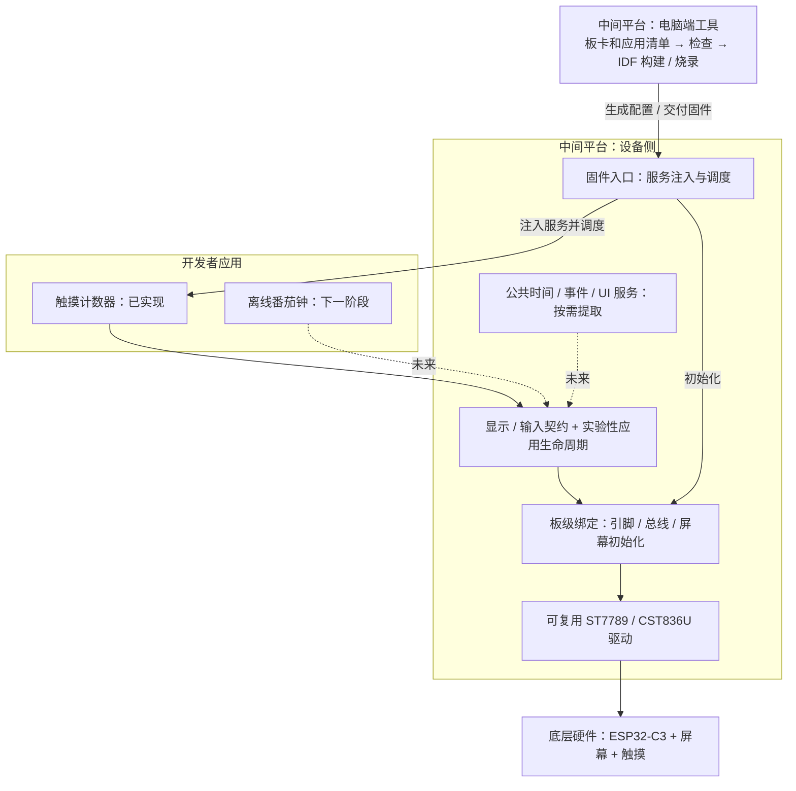

# 从首板到平台：增量架构路线

> 2026-10-27 约定更新：当前没有新硬件，先完善现有板的体验、文档与贡献流程；板 + 配件 + 组合方向保留，实施待真实配件验证，不先建空目录或通用框架。见[开发者边界](developer-boundaries.zh-CN.md)。

当前先验证一条完整链路：**应用声明需求 → 选择板卡 → 检查能力 → 构建 → 烧录 → 实机验收**。
第一块板跑通说明链路成立；同一份应用在第二块板不改代码跑通，才说明平台抽象初步成立。

## 三层与电脑端工具

契约定义“应用可以用什么”，运行服务处理多个应用都需要的共同行为。
目前生命周期由 `firmware/main` 承担，**并没有完整的通用运行服务层**。
电脑端工具与设备侧配合：前者选型、检查、构建、交付；后者在板上执行应用。
商家提交的驱动最终接入板级绑定；仅提交一个硬件描述文件还不能让未知芯片自动工作。

## 阶段与验收门槛

| 阶段 | 应用 / 硬件 | 平台增量 | 必须验证的结果 |
| --- | --- | --- | --- |
| 0：硬件基线 | 现有 C3 触摸屏板 + bringup | 固定驱动参数、显示/输入契约、保留诊断应用 | 红绿蓝白黑正确、触摸应答；冷启动和坐标方向另验 |
| 1：首个应用闭环 | 同板触摸计数器 | 单应用生命周期、需求清单、静态匹配、构建/烧录命令、主机测试 | 点击加一、长按仅一次、RESET 清零；断电后回到 0000；团队成员可复现 |
| 2：真实公共服务 | 同板离线番茄钟 + Snake | 注入 time/storage；应用侧共享画布；C3 NVS 适配；显式未验收 bring-up 路径 | 番茄钟 2 分钟完整一轮通过；Snake 可玩并做硬件验收；持久化边界另测 |
| 3：跨板验证（下一步） | 再选一块资料完整、屏幕配置不同的 ESP32 开发板 | 新增板级描述与绑定；复用已有驱动或新增驱动 | 两个应用源码不改，通过不同板卡参数构建并实机验收；内存、尺寸、触摸差异被适配层处理 |
| 4：外部厂商接入 | 一位团队外的硬件贡献者 | 双语接入指南、提案模板、能力检查和可复现验收记录 | 贡献者按文档独立提交板包，CI 检查与实机证据均可追溯 |
| 5：应用生态 | 外部作者应用；按需求接 AI 或本地服务 | 稳定 SDK、兼容矩阵、签名/更新方案；验证后再考虑 IR 和包分发 | 外部开发者能独立交付应用，声明需求即可得到可解释的匹配结果 |

第二块板不必立即买 S3：先依据目标应用所需内存、屏幕资料和可购性选择。
当前板的色带已确认 SPI mode 3、反色开启、RGB565 小端；这些参数属于适配层，不能出现在业务应用中。

## 当前状态（2026-10-26）

| 阶段 | 状态 | 依据 |
| --- | --- | --- |
| 0 硬件基线 | 完成 | 色带、方向与触摸坐标均已实机验收（5/5 对应），见 `tests/hardware/records/` |
| 1 首个应用闭环 | 完成 | 计数与重置实机验收；CI 在干净容器里复现三个应用的构建 |
| 2 真实公共服务（番茄钟） | 首版通过 | 时钟通过契约注入，应用不碰 `esp_timer`；已用 2 分钟版完整跑完一轮并验收；25 分钟真实时长未等过 |
| 2 附加应用与持久化 | Snake 已验收；最高分断电恢复未验 | time/storage 契约和 C3 NVS 已接入；新板尚无 storage 实机证据 |
| 3 跨板验证 | 未开始 | 需要先决定并接入第二块板 |
| 4 外部厂商接入 | 流程文档已备，尚无外部贡献 | 有双语指南和提案模板；需要由非维护者完成一次端到端接入 |
| 5 应用生态 | 未开始 | 先稳定 SDK 与兼容性矩阵 |

## 本轮交付的边界

- `apps/touch-counter` 只依赖 `contracts/` 和 C 标准库；最小 160×160、RGB565、指针输入。
- `apps/bringup` 保留五条色带和触摸日志，用于区分硬件问题与应用问题。
- `firmware/main` 初始化板卡、注入能力、每 20ms 调用应用；错误后停止并清理。
- `tools/dada.py` 依据本地清单做最小兼容检查，再调用 ESP-IDF；`--allow-unverified` 只用于显式的本地诊断构建，不代表支持。
- `app.json` 和生命周期 API 均属实验版本，不承诺 ABI、动态安装、多应用并行。
- 当前按板卡/应用隔离构建产物；`firmware/sdkconfig` 仍是同一 C3 工程的本机配置，跨芯片目标隔离留待阶段 3。

## 接下来按什么顺序做

1. 找一位非维护者按照板卡接入指南走完一次 bring-up，记录实际耗时和需要问人的步骤。
2. 决定第二块 ESP32 板并同时验证计数器、番茄钟和 Snake；应用中出现 GPIO、芯片型号或驱动分支时，回到适配层解决。

AI 服务是后续可选连接器。先让无网络、无账号的应用成立，再为确实需要 AI 的应用定义服务契约。
