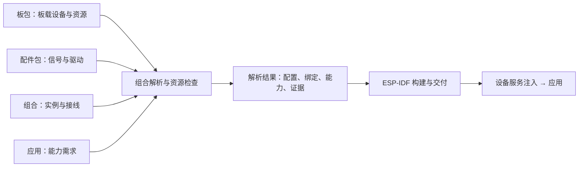

# dada：开发板、配件与组合配置

状态：架构方向已确认；实施暂缓，未实现。2026-10-27。

## 后续约定（优先于下文实施顺序）

用户确认：当前没有新增硬件，先文档化边界，不创建空模块目录，不实施通用组合框架。保留现有一体板结构；待真实配件最小适配后，再提取模块/组合。下文分阶段方案作为后续参考，不是当前开发任务。开发者入口以[平台边界](../../architecture/developer-boundaries.zh-CN.md)为准。

## 意图与已确认方向

用户认可将开发板、可复用配件、具体接线组合分开，让硬件贡献者贡献一次适配，应用通过能力契约复用。
应用不引用板卡型号、配件型号或 GPIO；具体组合仍必须具备驱动实现和实机证据。

## Approaches / 方案选择

1. 每次加配件复制整个板包：短期简单，但板载配置与驱动重复，维护成本随组合增加。
2. 独立 board + module + composition：用户已选择此方向。模块描述可复用，组合保存接线与实例；增加解析和资源检查工作。
3. 自动发现配件并动态加载驱动：需要额外硬件协议和运行时，不适合当前静态 ESP-IDF 固件，暂不采用。

实施建议由本设计提出：保留现有板包路径，不先迁移到 hardware/boards；采用构建期静态装配。

## 当前代码与迁移约束

- 当前板包在 `hardware/<vendor>/<board>/`；CLI 扫描两层目录，CMake 按板 id 定位板包。
- `board.json` 生成头文件，`board/board.c` 初始化板载屏幕、触摸、时钟、NVS。
- `firmware/main/main.c` 注入固定服务，并假定显示存在；新增无屏目标时必须消除此假定。
- 当前 CLI 仅识别 display/input/time/storage；尚无 audio 契约、可选能力解析或组合选择。
- 保留 `--board` 的现有用法和四个应用；它等价于不带外接配件的基础目标。
- 新增 `--composition`，与显式 `--board` 互斥；均未指定时保留现有默认板。
- 本次设计不声称现有板有可用扬声器接口。此前示意 GPIO 4/5/6 已用于板载触摸/显示，不是推荐接线。

## 三类描述与代码边界

| 类型 | 路径 | 负责内容 |
| --- | --- | --- |
| 开发板 | hardware/<vendor>/<board>/board.json + board/ | 固定板载硬件、USB/Flash、占用资源、可用扩展接口、板级初始化 |
| 配件 | hardware/modules/<vendor>/<module>/module.json | 模块身份、信号名、总线/电气要求、提供能力、驱动与绑定入口 |
| 组合 | hardware/compositions/<id>/composition.json | 板引用、模块实例、接线、服务选择、组合验收证据 |
| 公共驱动 | components/ | 控制器驱动与契约适配；不写具体板子的 GPIO |
| 应用 | apps/<app>/ | 必需/可选能力及其参数要求、业务逻辑和降级行为 |

板载屏幕和触摸暂时保留在现有板包，不为目录统一而拆迁。模块绑定负责把模块配置转换成驱动初始化参数，组合解析器生成配置与静态装配信息。JSON 不在 MCU 上解析，清单字符串也不作为 shell 命令执行。



## 组合与连接规则

组合引用一个板和零到多个模块实例；同型号模块可有多个实例，但 instance id 必须唯一。
模块描述使用逻辑信号名，组合将信号映射到板上引脚/连接器或命名总线。首版选择显式 GPIO 与命名总线，连接器别名以后再增加。

以下是概念形状，不是当前可用清单，也不能用于接线：

```json
{
  "composition_version": "0.1",
  "id": "example-board-with-audio",
  "board": "jinyichen-esp32-c3-lcd-2.4",
  "modules": [{
    "instance": "speaker",
    "module": "example-i2s-amplifier",
    "connections": {"bclk": null, "ws": null, "data": null}
  }],
  "providers": {"audio.output": "speaker"}
}
```

未知接线可以保留在草稿中，构建必须拒绝未解析的必需连接。无源扬声器通常需要功放，不能被建模为可直接接 GPIO 的音频能力。

资源检查先验证所有已配置硬件，再按应用需求选择服务；未被应用使用的配件也可能在物理上造成冲突。

- 板包明确扩展引脚是否实际引出、是否被板载设备/Flash/USB 占用，以及启动相关限制。没有资料时不将“未写在清单里”视为可用。
- 独占 GPIO 与外设控制器不能重复分配；报错指出两个占用方和对应清单字段。
- I²C 只有显式共用同一总线且参数兼容时允许共享 SDA/SCL；地址不能重复，除非以后明确支持多路复用器。
- SPI 仅在驱动允许共享且每个设备有独立片选时允许共享数据/时钟；当前板屏幕 CS 固定为低，不能推断为可共享。
- 记录电压和供电约束并检查已知不兼容项；软件检查不替代原理图、电流预算与实测。
- 首版拒绝未支持的连接种类/资源语义，不静默忽略。

## 能力、实现与验收

三个条件分开记录：清单声明了能力、存在支持该目标的驱动/绑定、当前组合已验证该能力。单纯添加 capability 字符串不能生成可烧录能力。

普通 check/build/flash 要求应用的必需能力满足三项条件及分辨率等约束。显式诊断模式只放宽实机验证，不放宽驱动缺失、接线未知、资源冲突或型号不兼容。

基础 --board 继续使用板级证据；显式 composition 的正式支持要求该组合自己的验收记录，不简单把各配件的 verified 列表求并集。零配件组合可引用完全相同板包内容对应的板级记录；添加配件后的组合需要集成复测，包括原有屏幕/触摸等相关功能。

验收记录绑定板、模块清单、接线、驱动来源版本/内容摘要与测试固件。解析结果保存源摘要；改变接线或相关实现后，旧证据不自动升级为新组合证据。源码构建可在诊断模式进行；面向体验者发布固件必须有对应组合与产物验收记录。

迁移规则（本设计建议）：第一步保留旧 `--board` 的 verified_capabilities 判断，但输出其为旧版板级证据，不能声称已建立摘要追溯。新 `--composition` 路径采用新证据规则；零配件组合在缺少可关联的历史产物/源码记录时先走显式诊断模式。不得将当前源码摘要回填成历史实测事实。待实际复测或确有可追溯的原始记录后，才可通过组合普通模式并发布。这样四个应用的旧命令保持可用，新组合基础设施可在没有设备的环境中实施和测试。

## 必需与可选能力

- required：缺少即拒绝构建/烧录；说明缺哪项、哪个提供者未适配或未验收。
- optional：缺少不阻止构建，但不注入可用服务，应用须实现降级；可用时显式选定提供者。
- 多个模块提供同一能力时，用 providers 明确选定，不能按目录顺序选择。
- 将来的音频应区分 audio.output 与 audio.input，且输出参数需包含支持格式/采样率等；首版组合基础设施不虚构通用 audio 契约。
- 未声明需求的能力不自动初始化。必需服务初始化失败时清理并终止；可选服务失败时清理该服务、记录错误并降级。
- 接上配件不代表驱动可探测其物理存在。比如 I²S 功放未必有读回通道；平台不能承诺检测出扬声器断线。

## 分阶段范围与验收

### 第一步：组合基础设施

增加版本化 module/composition Schema、解析器、资源与能力匹配、诊断输出、组合构建目录隔离与生成配置。
提供当前 C3 的零配件组合，复用原板绑定，四个现有应用无需修改业务源码即可构建。
主机测试用明确标记的虚拟板/模块覆盖两块板不同接线、GPIO 冲突、总线共享与地址冲突、缺驱动、缺必需能力、可选能力降级、多提供者、失效证据。
虚拟例子不进入受支持硬件目录或固件发布目录；不能作为“已经支持音频”的证据。

### 第二步：一个真实外接模块

根据现有板原理图与可用接口选择模块；不预设扬声器一定接得上。补模块绑定，验证初始化、应用访问、异常清理、与板载屏幕/触摸共存。
若选音频，再定义最小输出契约及测试应用；若选按钮，定义其输入语义，不能把按钮伪装成触摸指针。
只有实际完成这一步，才对外宣称支持可组合配件。

### 第三步：跨板复用与便捷交付

同一模块在另一块资料齐全的板上仅修改组合接线/板级适配，复用模块驱动和应用源码，并建立第二份组合证据。
后续网页刷机按“应用 + 精确组合 + 固件版本”选择已发布产物；USB 芯片型号不足以推断真实接线。

## 非目标与实现者可决定事项

当前不做热插拔、任意芯片移植、自动猜线、云包市场、动态驱动加载或无硬件验证的音频支持。
仍使用 Python、CMake、ESP-IDF 5.4.2、原生 C 契约。内部类/函数组织、测试夹具及具体序列化字段可在实施计划中确定；必须保留上述兼容与检查语义。

设计交付不修改已有固件行为。代码实施暂缓；待真实硬件验证后重新制定实施计划。
